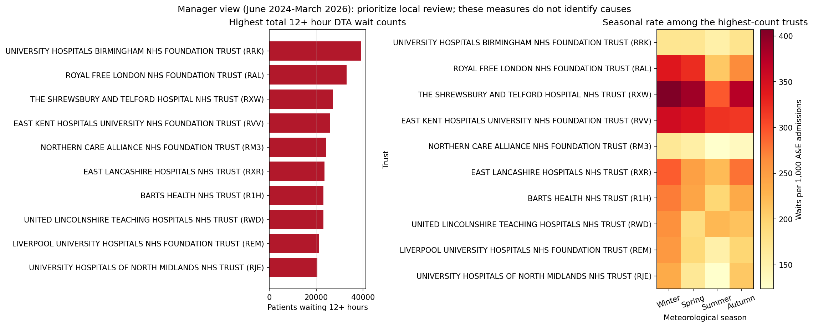

# NHS Waiting Times Analysis (SQL + Python)

> Work in progress: Phase 1 of my Public Services Data Portfolio.

## Business question
How do 12+ hour waits from decision to admit (DTA) vary by trust and season,
and how do admission-normalized counts relate to A&E activity?

**Purpose:** Help hospital managers identify where and when to investigate
operational pressure. The analysis is descriptive; it is not a quality ranking,
causal analysis, or intervention recommendation engine.

## Data
NHS England statistics: A&E attendances and emergency admissions
https://www.england.nhs.uk/statistics/statistical-work-areas/ae-waiting-times-and-activity/

Raw source files are kept locally in `data/raw/` and are not committed.

## Tools
SQLite, Python (pandas), Streamlit, Jupyter, seaborn / matplotlib

## Project structure
```
data/raw/      original downloaded CSVs (not committed)
data/clean/    cleaned aggregate CSV for the dashboard; other outputs are generated
sql/           SQL queries, numbered in the order I learned them
notebooks/     analysis notebook
scripts/       repeatable data loading, cleaning, EDA, and chart generation
dashboard.py  interactive Streamlit dashboard
images/        charts used in this README
```

## How to run
```bash
python -m venv .venv
source .venv/bin/activate        # Windows: .venv\Scripts\activate
pip install -r requirements.txt
# put CSV files in data/raw/, then:
python scripts/load_data.py
python scripts/eda_report.py
python scripts/chart_summary.py
python scripts/activity_waits_analysis.py
streamlit run dashboard.py
```

The dashboard filters by date, season, parent organization, and trust. It
compares threshold counts, counts per 1,000 A&E emergency admissions, seasonal
patterns, and activity; it does not estimate wait durations or prescribe
operational changes.

## Deploy the dashboard
The cleaned, trust-month aggregate in `data/clean/ae_monthly.csv` is included so
the hosted dashboard can run without the local SQLite database or raw monthly
files. To publish it on Streamlit Community Cloud:

1. Sign in at [share.streamlit.io](https://share.streamlit.io/) with GitHub.
2. Create an app from `chasimarshad-bot/nhs-waiting-times-analysis`, choose the
   `main` branch, and set the app file to `dashboard.py`.
3. Deploy the app, then use the URL Streamlit provides in your portfolio.

The app is not live until it is deployed from a Streamlit Community Cloud
account.

## First milestone: September 2025
Start with [NHS England's 2025–26 monthly release page](https://www.england.nhs.uk/statistics/statistical-work-areas/ae-waiting-times-and-activity/ae-attendances-and-emergency-admissions-2025-26/). Under September 2025, download **Monthly A&E September 2025 (revised 13.11.25) (CSV)**. Save it as `data/raw/ae_2025_09.csv` and run the loader above. The filename gives the SQLite table its name, `ae_2025_09`.

**First question:** Among reporting providers with Type 1 (major A&E) activity, which had the highest share of attendances lasting more than four hours from arrival?

1. Inspect the imported columns and a few rows. Identify the provider code, the Type 1 attendance count and the Type 1 count over four hours.
2. Check for summary rows, duplicate provider codes, missing counts and counts over four hours that exceed total attendances.
3. For provider rows with valid counts and at least one Type 1 attendance, divide the Type 1 count over four hours by total Type 1 attendances. Multiply by 100 and display the attendance count alongside the percentage so readers can see the effect of small denominators.

This measure starts at arrival and ends at admission, transfer or discharge. NHS England also publishes a separate measure that starts at the decision to admit.

## Key findings (June 2024 to March 2026)
The 22 uploaded aggregate CSVs cover one consecutive month each. Cleaning read
4,386 source rows and excluded 22 national summary rows (21 marked `TOTAL` in
`period`; the February 2026 summary was marked `TOTAL` in the organization
fields). The resulting `ae_monthly` table has 4,364 provider-month rows, 22
months, and 207 distinct organization codes. 188 codes have all 22 months;
the other 19 have partial coverage.

All files contained the 22 required data fields. The September 2024 file had
six extra columns (`a`, `unnamed_22` through `unnamed_26`), which were removed
from the cleaned table and recorded in the quality report. Eight organization
codes changed name; summaries use `org_code` as the stable key and show the
latest name. There were no missing required values, invalid numeric counts,
negative counts, unparsed months, or duplicate month/code rows.

Across each season's observed months, the national 12+ hour DTA wait counts and
normalized values were:

| Meteorological season | Months | 12+ hour DTA wait counts | Mean monthly count | Median monthly count | Counts per 1,000 A&E emergency admissions |
|---|---:|---:|---:|---:|---:|
| Winter | 6 | 340,314 | 56,719 | 54,428 | 144.19 |
| Spring | 4 | 180,970 | 45,243 | 45,657 | 111.29 |
| Summer | 6 | 213,465 | 35,578 | 36,358 | 87.75 |
| Autumn | 6 | 284,026 | 47,338 | 47,704 | 116.07 |

Winter had the highest aggregate count per 1,000 A&E emergency admissions, and
summer the lowest. Spring has only four observed months; this is a descriptive
comparison over less than two complete annual cycles, not evidence that season
causes the difference.

Counts and normalized values identify different trusts: University Hospitals
Birmingham had the largest total of 12+ hour DTA waits (39,231 across 22
months), while Croydon Health Services had the highest count per 1,000 A&E
emergency admissions among trusts observed for at least 18 months (492.63;
13,277 waits). These measures describe recorded counts, not typical wait
duration or care quality.

In the latest month, March 2026, Royal Free London recorded the largest 12+
hour DTA count (1,771), followed by University Hospitals Birmingham (1,511)
and Barts Health (1,207).

The scripts write `ae_monthly.csv`, `data_quality_report.csv`,
`monthly_eda_summary.csv`, `seasonal_eda_summary.csv`,
`trust_seasonal_eda.csv`, and `trust_eda_summary.csv` under `data/clean/`.
Generated charts are saved under `images/`.


The source schema contains attendance counts, counts of attendances over four
hours, and counts of patients waiting 4-12 or 12+ hours from decision to admit.
It does not contain each patient's elapsed wait duration, so mean or median
wait-duration estimates cannot be calculated from these data. EDA mean/median
values refer to monthly patient counts, not minutes waiting.

## Next hypothesis: activity and 12-hour waits
Does higher A&E activity correspond to more patients waiting 12 or more hours
from decision to admit (DTA)? `sql/05_activity_and_12_hour_waits.sql` derives
monthly attendance, 12-hour wait, and emergency-admission counts per trust.
Run `python scripts/activity_waits_analysis.py` to calculate the descriptive
Pearson correlation between trusts' average monthly activity and average monthly
12-hour waits, and compare it with the wait rate per 1,000 A&E admissions. The
script saves `images/activity_vs_12_hour_waits.png`. Across 207 trusts, the
Pearson correlation between mean monthly A&E attendance volume and mean monthly
12+ hour DTA wait counts is 0.667. This is descriptive and partly reflects
trust size; it does not show that activity causes waits. The comparison with
counts per 1,000 admissions helps separate volume from relative burden. See
.

## Supported alternative hypothesis: seasonal variation by trust
The data supports testing whether 12+ hour DTA wait counts and
admission-normalized values vary by meteorological season and trust.
`python scripts/eda_report.py` writes mean/median monthly counts by trust and
season, and `images/manager_seasonal_waits.png` shows the highest-count trusts
and their seasonal values. Use high counts or normalized values to prioritize
local pathway review; the dataset does not identify causes or rank care quality.



The seasonal comparisons cover only 22 months, with four spring months. They
are descriptive and do not establish that season causes differences. The
threshold fields are counts (4-12 and 12+ hours from DTA to admission), not
elapsed durations. Mean and median duration cannot be computed; values above
are monthly patient counts.

Machine learning is not being used for recommendations. These aggregate
indicators do not describe staffing, capacity, patient mix, or intervention
outcomes, so a model could not establish which operational change would improve
waits. Review high-count/high-rate periods with local operational and case-mix
data before choosing an intervention.

## Data needed for valid duration statistics
The 22 monthly A&E source CSVs used by the notebook can support the count-based
analyses above. For actual per-trust, per-month mean wait duration, an additional
non-identifying aggregate is needed for each explicitly defined wait (for
example, A&E arrival-to-departure or DTA-to-admission): `org_code`, `period`,
`wait_definition`, `patient_count`, and `total_wait_minutes`. For an exact
median, provide a frequency distribution with `wait_duration_minutes` and
`patient_count` for each duration, grouped by trust, period, and wait
definition. Coarse duration bands only support an approximate median. Do not
upload patient identifiers, encounter-level records, or timestamps.

## What I learned / next steps
I learned that NHS monthly exports can have inconsistent extra columns even when
the core schema is stable, so combining tables requires a reference column set
and explicit removal of stray columns. I also learned to convert the coded
`MSitAE-MONTH-YEAR` period field into a real date before ranking or comparing
months.

Next steps are to obtain the aggregate duration summaries described above if
mean/median wait durations are needed, and to pair any manager review with
operational context before making improvement recommendations.
