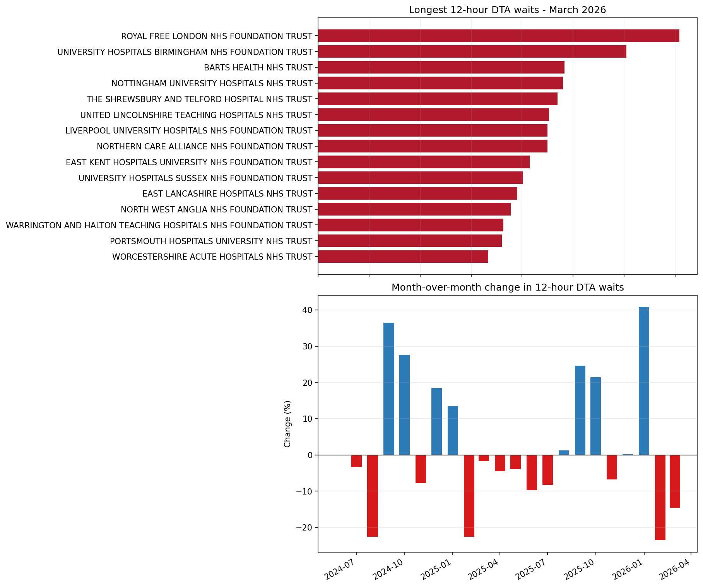
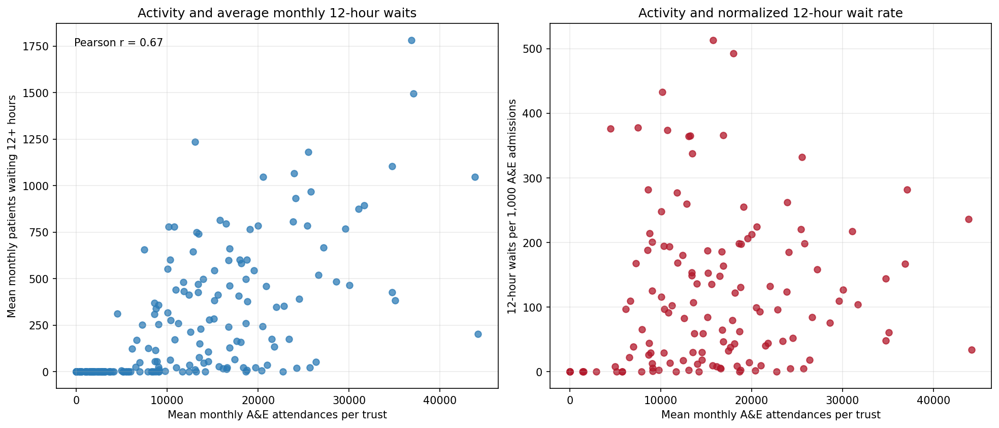

# NHS A&E Waiting Times Analysis

> **Live dashboard:** [Open the Streamlit dashboard](https://nhs-waiting-times-analysis-qdjsfpjiujjt4ym74pigt4.streamlit.app/)
>
> Portfolio project using NHS England aggregate data, Python, SQL, SQLite, Jupyter, and Streamlit.

## Project overview

This project explores how long waits in NHS England's monthly A&E statistics vary by trust and season, and how the recorded counts compare with A&E activity. The analysis is intended to help identify patterns that may warrant further local investigation; it is descriptive, not a trust ranking or a source of causal or intervention claims.

The main questions are:

- How do patients recorded as waiting 12 or more hours from decision to admit (DTA) vary by trust and meteorological season?
- How do those counts compare across trusts when expressed per 1,000 emergency admissions via A&E?
- How are trust-level wait counts associated with average monthly A&E attendance volume?

## Dashboard

The interactive dashboard filters the aggregate data by reporting period, season, parent organization, and trust. It presents national summary metrics, seasonal comparisons, trust-level rankings, and an activity comparison.

[Launch the live Streamlit dashboard](https://nhs-waiting-times-analysis-qdjsfpjiujjt4ym74pigt4.streamlit.app/)



## Data and method

The source is [NHS England's A&E attendances and emergency admissions statistics](https://www.england.nhs.uk/statistics/statistical-work-areas/ae-waiting-times-and-activity/). The analyzed monthly extracts cover June 2024 through March 2026.

The repository includes `data/clean/ae_monthly.csv`, a cleaned trust-month aggregate with 4,364 rows across 22 months and 207 organization codes. The 22 downloaded source CSVs in `data/raw/` and the generated SQLite database are not committed. The aggregate CSV is sufficient to run the hosted dashboard; the notebooks and data-processing scripts that use SQLite require the source files to be downloaded locally and loaded first.

The loading script standardizes columns, removes national total rows, parses reporting months, and records data-quality checks. Analysis scripts create monthly and seasonal summaries, trust-level comparisons, and charts. The notebooks and numbered SQL files provide exploratory and query-based analysis.

## Findings

Across each season's observed months, national 12+ hour DTA wait counts and admission-normalized counts were:

| Meteorological season | Months observed | 12+ hour DTA wait counts | Mean monthly count | Median monthly count | Counts per 1,000 A&E emergency admissions |
|---|---:|---:|---:|---:|---:|
| Winter | 6 | 340,314 | 56,719 | 54,428 | 144.19 |
| Spring | 4 | 180,970 | 45,243 | 45,657 | 111.29 |
| Summer | 6 | 213,465 | 35,578 | 36,358 | 87.75 |
| Autumn | 6 | 284,026 | 47,338 | 47,704 | 116.07 |

Winter had the highest aggregate count per 1,000 emergency admissions and summer the lowest. Spring includes only four observed months, and the full period covers less than two annual cycles; these are descriptive comparisons, not evidence that season causes differences.

University Hospitals Birmingham had the largest total of 12+ hour waits across the period (39,231). Among trusts observed for at least 18 months, Croydon Health Services had the highest count per 1,000 A&E emergency admissions (492.63; 13,277 waits). In March 2026, Royal Free London recorded the largest 12+ hour count (1,771).

Across 207 trusts, the Pearson correlation between mean monthly A&E attendance volume and mean monthly 12+ hour DTA wait counts was 0.667. This association is descriptive and partly reflects differences in trust size; it does not show that activity causes waits.




## Interpretation and limitations

- The 12+ hour measure is a **patient count** for waits from decision to admit to admission. The data does not contain individual elapsed wait durations, so mean or median wait time in minutes cannot be calculated.
- Counts per 1,000 A&E emergency admissions are a scale comparison, not a probability that an admitted patient waited 12 hours; the numerator and denominator describe different reported activity.
- The aggregates do not include staffing, capacity, patient mix, or intervention outcomes. They cannot establish causes, assess care quality, or identify which operational change would improve waits.
- The seasonal view covers 22 months, including only four spring months. Interpret it as an exploratory signal and review it alongside local operational context.
- Machine learning is not used to make recommendations.

## Repository structure

```text
data/
  clean/ae_monthly.csv       Committed cleaned trust-month aggregate
  raw/                       Local source CSVs; not committed
images/                      Generated charts used in this README
notebooks/
  01_explore.ipynb           Initial data exploration
  02_sql_analysis.ipynb      SQL-based analysis notebook
scripts/
  load_data.py               Clean source CSVs and build the SQLite database
  eda_report.py              Monthly, seasonal, and trust summaries
  chart_summary.py           Summary chart generation
  activity_waits_analysis.py Activity and wait-count comparison
sql/                         Numbered SQL queries, including activity analysis
dashboard.py                 Interactive Streamlit dashboard
requirements.txt             Python dependencies
```

## Run locally

Use Python 3 and install the dependencies:

```powershell
python -m venv .venv
.venv\Scripts\Activate.ps1
pip install -r requirements.txt
```

To run only the dashboard, start it with the committed aggregate CSV:

```powershell
streamlit run dashboard.py
```

To reproduce the data pipeline and notebook analyses, download the monthly NHS England CSV extracts for the period above and place them in `data/raw/`. Then run:

```powershell
python scripts/load_data.py
python scripts/eda_report.py
python scripts/chart_summary.py
python scripts/activity_waits_analysis.py
jupyter notebook
```

The loader creates the local `data/nhs.db` database and cleaned outputs under `data/clean/`. The database and raw source files are intentionally ignored by Git; the committed aggregate CSV remains available for dashboard deployment.

## Project ownership and AI assistance

This is presented as an individual portfolio project. GitHub Copilot was used as an AI assistant during implementation and documentation. The data source, transformations, findings, and limitations are documented in the repository so the work can be reviewed and reproduced.
